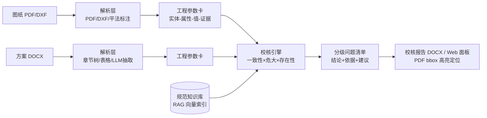

# 施工图 × 施工方案 协同智能校核系统

> 面向土建施工场景的 AI 校核工具：把施工图（PDF/DXF）与施工方案（DOCX）各自解析为**可溯源的"工程参数卡"**，自动执行 **一致性比对 / 危大工程识别 / 方案合规检查**，输出每条带证据定位的校核报告（DOCX）。

[](https://github.com/yuluo554/construction-drawing-plan-checker/actions/workflows/ci.yml) []() []() [](https://github.com/yuluo554/construction-drawing-plan-checker#开发方式)

## 为什么做这个

施工图在 CAD/PDF 世界，施工方案在 Word 世界，"两张皮"导致：

- **关键参数易错**：混凝土强度、支撑高度等在两套文档间不一致；
- **校核靠人工**：技术员逐页翻图对照方案，效率低、易漏项；
- **危大管控薄弱**：方案是否达到"危大工程/超规模（须专家论证）"阈值，全凭经验。

本系统把两侧文档统一解析为结构化参数卡，用 **规则引擎 + RAG 规范库双通道** 自动校核——结论每条可溯源（图纸 bbox 坐标 / 方案章节原文），LLM 只做兜底与摘要，数值结论全部来自确定性规则，杜绝幻觉进报告。

## 核心特性

- 📐 **图纸解析**：矢量 PDF / DXF，平法标注（22G101 梁/柱/板）专用解析器，输出带 bbox 坐标的构件参数卡
- 📄 **方案解析**：章节树 + 表格键值 + LLM 结构化抽取（每值必须回溯原文，防幻觉校验）
- ⚖️ **一致性校验**：别名归一（砼→混凝土）、单位换算（m↔mm）、多值消歧、冲突分级（致命/一般/提示）
- 🚨 **危大合规**：住建部令 37 号 / 建办质〔2018〕31 号附件阈值表驱动，自动判定"危大 → 专项方案"、"超规模 → 专家论证"
- 📚 **规范 RAG**：48 号指南 + 危大清单向量化检索，致命项自动附条文依据
- 📝 **报告导出**：分级问题清单（双侧证据 + 条文依据）+ 签署栏的 DOCX 报告
- 🖥 **Web 界面**：上传即校核，PDF 证据红框高亮定位，报告一键下载

## 架构



## 快速开始

环境要求：Python **3.10+**（CI 覆盖 3.10 / 3.12 × Ubuntu / Windows），可选大模型 API（阿里云百炼等 OpenAI 兼容接口）。

```bash
git clone https://github.com/yuluo554/construction-drawing-plan-checker.git
cd construction-drawing-plan-checker
pip install -e ".[dev]"          # 也可 cd code/backend && pip install -r ../requirements.txt

# 装完先自检：确认知识库/阈值清单/Web 静态文件都就位
construction-check selftest      # 或 cd code/backend && py -m app.cli selftest

# 方式一：Web 界面（推荐）—— 在 code/backend 下启动
cd code/backend
uvicorn app.server:app --port 8000        # 打开 http://127.0.0.1:8000

# 方式二：CLI 端到端（规则通道，不需要 API Key）
py -m app.cli run ../../data/施工图纸/自制样例/sample_beam_plan.dxf \
                  ../../data/施工方案/自制样例/sample_formwork_plan_13.docx \
                  -o ../../输出 --rag

# 运行测试（67 项，零 API 依赖；README 数字由 test_self_reported_numbers.py 守门）
pytest -q -m "not packaging"     # 含打包实测的完整跑法见下方「安装形态」
```

**安装形态（v0.1.1 起）**：`wheel` 与 `sdist` **都自带运行期资产**（知识库、危大阈值清单、Web 静态文件、规则元数据），因此 `pip install <wheel>` 之后 `compliance` / `--rag` / Web 界面都能直接用——不再需要仓库里的 `data/` 目录。

```bash
# 打包实测（真构建 + 装进临时 venv + 在仓库外验证资产来自包内）
pytest code/backend/tests/test_packaging.py -q -m packaging
```

**退出码约定**（v0.1.0 起）：`0` = 成功、`1` = 运行失败（解析异常 / 流水线节点失败 / 未产出结果 / 资产缺失）、`2` = 用法或输入不可用（文件不存在 / `--rag` 缺 embedding 配置）。`--rag` 需要 embedding 服务配置，缺配置或知识库缺失时**提前失败并给出指引**，不会静默产出空结果。

可选 LLM：复制 `code/.env.example` 为 `code/.env`，填入 API Key 后加 `--llm` 开关启用 LLM 抽取与兜底（规则命中不耗 API）。

## 基准与评测（内置可复现）

```bash
cd code/backend
py tools/bench_drawings.py 30 1        # 图纸解析：30 张随机图纸 vs 真值（seed 1）
py tools/bench_consistency.py 15 1     # 配对校核：15 组植入已知差异的图纸+方案
py tools/bench_rag.py                  # 规范检索：离线复算 5 个查询的 top1（零 API）
py tools/build_kb.py                   # 重建规范知识库（需 API Key）
py tools/build_rag_probes.py           # 重建检索探针夹具（需 API Key，KB 变更后跑）
```

**三个基准都是真门**：指标未达标时脚本 `exit 1`（不是只打印）。负控方式示例：`py tools/bench_drawings.py 30 1 --min-f1 1.01` 必然失败。

| 评测项 | 结果 | 复现方式 |
|--------|------|----------|
| 图纸解析（30 张随机图 / seed 1 / **873 字段**） | **P = R = F1 = 1.00**（0 误报 0 漏报） | `bench_drawings.py 30 1` |
| 方案 LLM 抽取（8 万字真实方案 / 1341 候选行） | 202 条抽取，**5 条幻觉拦截**，0 失败 | 需 API Key，**本轮未复核** |
| 配对一致性校核（15 组植入差异） | **植入差异检出 7/7，危大判定 15/15，误报 0** | `bench_consistency.py 15 1` |
| 危大阈值判定（基坑/模板/脚手架边界用例） | 分级全对 | `pytest -q` |
| 规范检索（5 类问题 × 55 条文块） | top1 全命中，相似度 **0.6514–0.8021** | `bench_rag.py`（离线） |

> 图纸解析的样本量随种子变化（`bench_drawings.py` 是逐张递增种子）：seed 1 为 873 字段、seed 2 为 867——引用该数字时必须写明种子。

## 目录结构

```
├── plan/            设计文档（需求分析/架构/模块设计/数据计划/里程碑）
├── data/            样例数据与知识库（台账见 data/README.md）
│   ├── 施工图纸/    FloorPlanCAD 抽样 + 程序化自制平法图纸（带真值）
│   ├── CAD样例/     LibreDWG / ezdxf 官方样例
│   ├── 法规标准/    建办质〔2021〕48号编制指南（官方 docx）+ 危大阈值清单 JSON
│   └── 施工方案/    高支模真实方案样例 + 程序化自制方案（可植入已知差异）
├── code/
│   ├── backend/     解析器 / 参数卡 / 规则引擎 / RAG / Agent 编排 / 报告导出 / Web 服务
│   │   ├── app/     应用代码
│   │   ├── tests/   67 项单元/集成测试
│   │   ├── tools/   基准与生成器（bench_*.py / gen_sample_*.py / build_*.py）
│   │   └── static/  Web 前端（index.html + app.js + vendor）
│   ├── rules/       校核规则库元数据
│   └── knowledge/   规范条文向量索引 + 检索探针夹具
├── .github/workflows/ci.yml  CI：3.10/3.12 × Ubuntu/Windows
├── pyproject.toml   版本与安装元数据（version 0.1.0）
└── MANIFEST.in      源码包（sdist）自足性清单
```

## 数据说明

- 自制数据由 `code/backend/tools/gen_sample_*.py` 程序化生成，参数随机可复现，**带真值 JSON**，可低成本扩充到任意规模；
- 开源数据：FloorPlanCAD（Apache-2.0）、LibreDWG / ezdxf 官方样例；
- 法规文件来自中国政府网公开发布（建办质〔2021〕48号），阈值清单为机器可读整理版，使用前请与官方文本核对；
- 高支模方案样例来自公开仓库 CallStorm/SmartReview，含真实项目信息，二次使用请注意脱敏。

## 已知限制

- 扫描版（图片型）图纸需 OCR 通路（预留接口，未在本原型实现）；
- DWG 需先用 ODA File Converter 转 DXF（转换未集成自动化）；
- 规范库当前仅覆盖危大管理文件族，JGJ 130 等技术规范条文待扩充；
- 危大判定按参数阈值，不替代专家论证等法定程序。

## 开发方式

本项目由 **[yuluo554](https://github.com/yuluo554)** 与 **ZCode（AI 编程智能体）** 协作完成：需求解读、架构设计、评测把关与发布由人主导；解析器编码、基准构建、文档生成等由 ZCode 按本文档的方法论执行（提交记录含 `Co-authored-by: ZCode` 署名）。

## License

[MIT](LICENSE)
